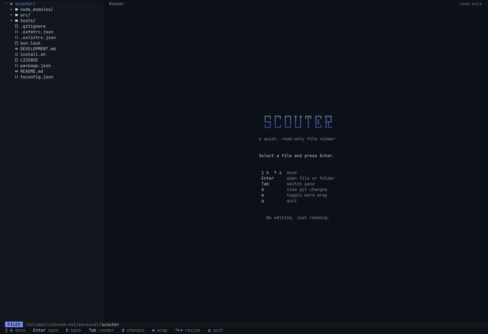

# Scouter

A read-only terminal file viewer with a built-in git diff screen. Browse a folder, read any file with syntax highlighting (Markdown shows rendered), and press `d` to see every change in your working tree on one page.



```sh
curl -fsSL https://raw.githubusercontent.com/indrazm/scouter/main/install.sh | bash
scouter .
```

Needs [Bun](https://bun.sh) 1.4.4+ and git.

## What you get

- **Review before you commit.** Staged, unstaged and new files, stacked in one scrolling diff. Jump between hunks with `n` / `p`.
- **Stays current.** Commit or save in your editor and the diff updates itself.
- **Read-only and safe.** It can't edit anything, never touches your git repository, and never runs code from the folder you open.
- **Quiet and fast.** No frames, no config. Vim-style keys, mouse optional.

## Keys

| Key             | Does                        |
| --------------- | --------------------------- |
| `j` `k` `h` `l` | Move, open, go back         |
| `Tab`           | Switch panes                |
| `d`             | Show / hide the diff screen |
| `n` `p`         | Next / previous change      |
| `a`             | All files / one file        |
| `s`             | Split / unified diff        |
| `m`             | Markdown: rendered / source |
| `w`             | Wrap long lines             |
| `q`             | Quit                        |

## Update or remove

```sh
scouter --upgrade
~/.scouter/install.sh --uninstall
```

Building on Scouter? See [DEVELOPMENT.md](DEVELOPMENT.md). Released under the [MIT License](LICENSE).
