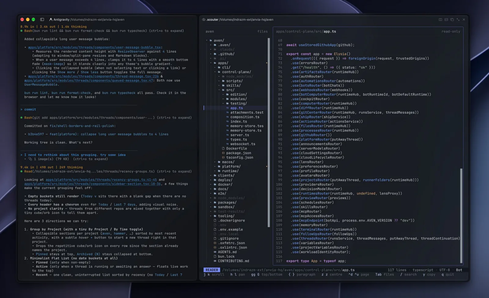
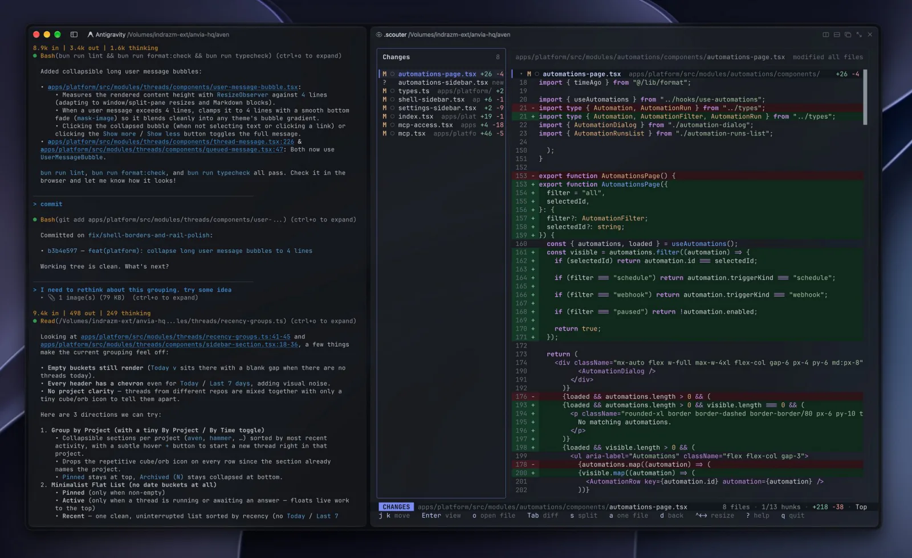
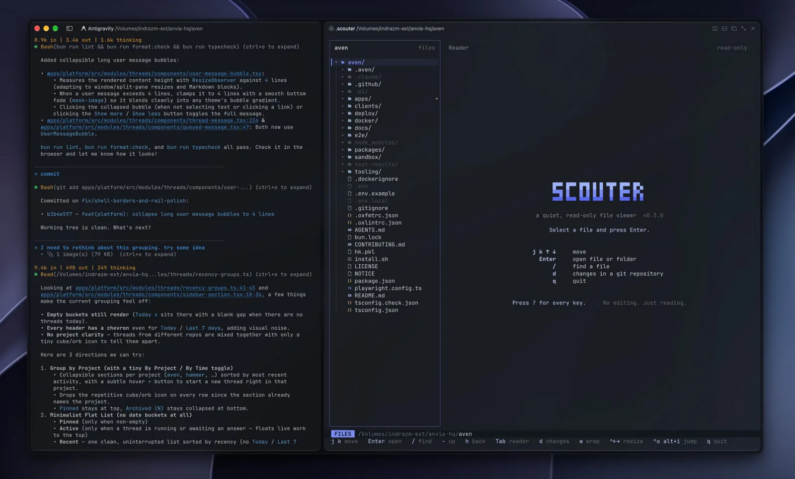

# Scouter

A read-only terminal file viewer with built-in git changes. Browse a folder, read any file with syntax highlighting (Markdown shows rendered, images show as pictures), and press `d` to see every change in your working tree on one page.



```sh
curl -fsSL https://raw.githubusercontent.com/indrazm/scouter/main/install.sh | bash
scouter .
```

Needs [Bun](https://bun.sh) 1.4.4+ and git.

## What you get

- **Review before you commit.** Staged, unstaged and new files, stacked in one scrolling diff. `●` means staged, `○` unstaged, `◐` both. Jump between hunks with `n` / `N`.
- **Feedback for your agent.** Click or drag line numbers in the diff and write a comment; press `e` (or click the comment count) to review them on the comments board—jump back, edit, delete, discard all, or copy them with their quoted code ready to paste into an agent. Comments stay in memory and are never written to disk.
- **Stays current.** Commit or save in your editor and the file list, its change marks and the open file update themselves.
- **Find anything.** Press `/` on the file list to find a file by name, then `Tab` to search the text inside every file, with the reader previewing the highlighted result. On an open file, `/` searches that file. Every match is highlighted.
- **Read-only and safe.** It can't edit anything, never touches your git repository, and never runs code from the folder you open.
- **Quiet and fast.** No config. Vim-style keys, mouse optional. The active pane is framed in indigo, and the colours follow your terminal between light and dark.





## Keys

| Key              | Does                                   |
| ---------------- | -------------------------------------- |
| `j` `k` `h` `l`  | Move, open, go back                    |
| `/`              | Find a file (`Tab`: text in all files) |
| `n` `N` `p`      | Next / previous match or change        |
| `Tab`            | Switch panes                           |
| `y`              | Copy selection, or the current path    |
| `Ctrl+o` `Alt+i` | Jump back / forward through places     |
| `d`              | Show / hide changes                    |
| `a`              | All files / one file                   |
| `s`              | Split / unified diff (wide)            |
| `c`              | Collapse / expand file diff            |
| `x`              | More / normal diff context             |
| `e`              | Review, copy or discard comments       |
| `o`              | Open the changed file at the hunk      |
| `m`              | Markdown: rendered / source            |
| `w`              | Wrap long lines                        |
| `{` `}`          | Previous / next paragraph              |
| `zz`             | Centre the match                       |
| `Space` `b`      | Page down / up                         |
| `gg` `G`         | Top / bottom                           |
| `120G`           | Go to line 120                         |
| `-`              | Open the folder above                  |
| `?`              | Every key                              |
| `q`              | Quit                                   |

## Update or remove

```sh
scouter --upgrade
~/.scouter/install.sh --uninstall
```

Building on Scouter? See [DEVELOPMENT.md](DEVELOPMENT.md). Released under the [MIT License](LICENSE).
